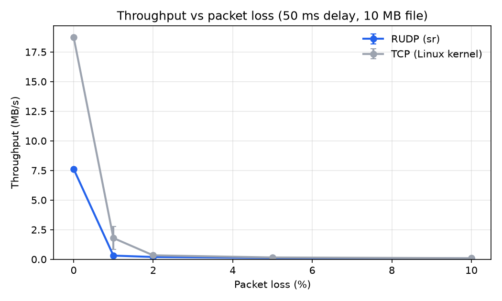
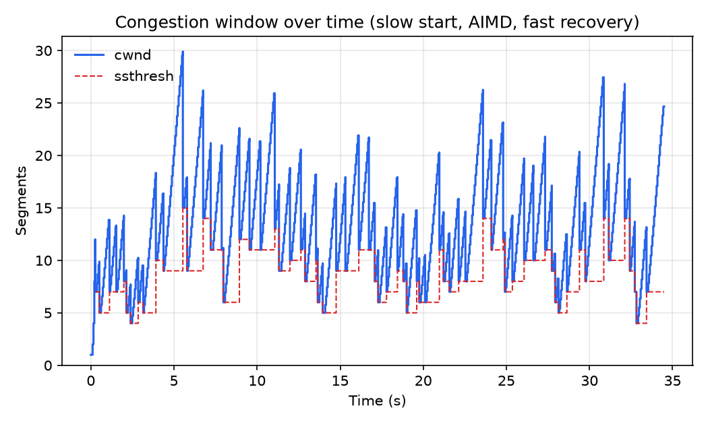
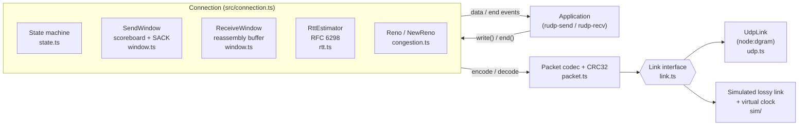

# RUDP: reliable transport over UDP

[](https://github.com/Navneesh004/rudp/actions/workflows/ci.yml)


[](LICENSE)

A TCP-like reliable transport protocol built on UDP in TypeScript, with selective repeat, RFC 6298 timeouts and Reno congestion control.

It covers the main parts of a transport layer: a three-way handshake, three reliability strategies (stop-and-wait, Go-Back-N, selective repeat with SACK), adaptive retransmission timeouts, flow control, NewReno congestion control and a FIN/ACK teardown. A deterministic network simulator tests it at up to 30% packet loss, and a Docker + `tc netem` setup benchmarks it against the Linux kernel's TCP.

## Results

<!-- After running `bash bench/run.sh` and `python bench/plot.py`, replace X/Y below with your numbers. -->



- At **5% loss**, RUDP reached **X MB/s** versus **Y MB/s** for TCP (50 ms delay, 10 MB file, average of 3 runs).
- At **10% loss**, a 10 MB transfer completes with matching SHA-256 hashes.
- Selective repeat resends only the missing segments, so it retransmits far less than Go-Back-N under loss (table below).



**Simulator comparison** (`npm run bench:sim`: 1 MiB, 50 ms RTT, deterministic, seed 3):

| Loss | Stop-and-wait | Go-Back-N | Selective repeat |
| ---: | ---: | ---: | ---: |
| 0% | 0.024 MB/s · 0 rtx | 1.824 MB/s · 0 rtx | 1.824 MB/s · 0 rtx |
| 1% | 0.023 MB/s · 11 rtx | 0.297 MB/s · 188 rtx | 0.325 MB/s · 13 rtx |
| 2% | 0.022 MB/s · 15 rtx | 0.126 MB/s · 175 rtx | 0.267 MB/s · 24 rtx |
| 5% | 0.021 MB/s · 34 rtx | 0.081 MB/s · 217 rtx | 0.122 MB/s · 51 rtx |
| 10% | 0.017 MB/s · 93 rtx | 0.027 MB/s · 366 rtx | 0.077 MB/s · 107 rtx |

With a window of segments in flight, Go-Back-N is ~75× faster than stop-and-wait on a clean link. At 10% loss, selective repeat is ~3× faster than Go-Back-N and sends ~3.4× fewer retransmissions. The selective-repeat column follows the Mathis et al. model for Reno, throughput ≈ (MSS/RTT)·(1.22/√p): at 1% loss that predicts 0.29 MB/s, and the simulator measures 0.33 MB/s.

## Architecture



The connection depends only on two small interfaces: a `Link` (send a datagram, receive datagrams) and a `Clock` (now, setTimeout). In production these are a UDP socket and the real clock. In tests they are a simulated link that drops, delays, duplicates, reorders and corrupts packets from a seeded RNG, driven by a discrete-event clock. A full 1 MB transfer at 30% loss therefore runs in milliseconds and gives the same result every time.

| File | Responsibility |
| --- | --- |
| [`src/packet.ts`](src/packet.ts) | 17-byte header, encode/decode, CRC32, SACK blocks, wraparound-safe sequence arithmetic |
| [`src/state.ts`](src/state.ts) | Connection state machine; illegal transitions throw |
| [`src/window.ts`](src/window.ts) | Sender scoreboard (outstanding / SACKed / lost) and receiver reassembly buffer |
| [`src/rtt.ts`](src/rtt.ts) | SRTT, RTTVAR, RTO and exponential backoff |
| [`src/congestion.ts`](src/congestion.ts) | Slow start, congestion avoidance, fast recovery, timeout reset |
| [`src/connection.ts`](src/connection.ts) | Ties it together: handshake, ACK processing, retransmission timer, teardown |
| [`src/udp.ts`](src/udp.ts) | UDP socket link and `connect()` / `listen()` helpers |
| [`src/sim/`](src/sim) | Virtual clock, seeded RNG, lossy link (used by tests and `bench:sim`) |
| [`baseline/tcp.ts`](baseline/tcp.ts) | The same file transfer over kernel TCP, for comparison |

## Packet format

Every packet is a 17-byte header followed by up to 65,535 bytes of payload (1,200 by default). All fields are big-endian.

| Offset | Field | Type | Meaning |
| ---: | --- | --- | --- |
| 0 | `seq` | uint32 | Sequence number of the first payload byte (SYN and FIN each consume one) |
| 4 | `ack` | uint32 | Next byte expected from the other side (cumulative ACK) |
| 8 | `flags` | uint8 | `SYN=1`, `ACK=2`, `FIN=4`, `SACK=8` |
| 9 | `window` | uint16 | Receiver's free buffer space, in segments (flow control) |
| 11 | `length` | uint16 | Payload length in bytes |
| 13 | `checksum` | uint32 | CRC32 of header + payload, computed with this field zeroed |

- **SYN** payloads carry `[version, mode]`, so the server takes on the client's reliability mode.
- **SACK** payloads are a list of `[left, right)` byte ranges the receiver holds beyond the cumulative ACK, as in TCP SACK (RFC 2018).
- A packet that fails the checksum or length checks is silently dropped and recovered like a lost packet.

## Design decisions

**Connection lifecycle.** The client sends a SYN with a cryptographically random initial sequence number. The server answers SYN+ACK and the client ACKs. Lost SYNs and SYN+ACKs are resent with exponential backoff. If the final ACK is lost, the client's first data packet completes the handshake. Closing works as in TCP: the side that calls `end()` sends a FIN once all its data is ACKed. The peer ACKs it and then sends its own FIN, and the first side waits in `TIME_WAIT` so it can re-ACK a FIN whose ACK was lost.

```
client:  CLOSED → SYN_SENT → ESTABLISHED → FIN_WAIT → TIME_WAIT → CLOSED
server:  CLOSED → LISTEN → SYN_RECEIVED → ESTABLISHED → CLOSE_WAIT → LAST_ACK → CLOSED
```

**Why selective repeat.** In Go-Back-N the receiver throws away everything after a gap, so one lost packet costs a whole window of retransmissions. In selective repeat the receiver buffers out-of-order segments and reports them in SACK blocks. The sender's scoreboard marks those segments as delivered and resends only the holes. A segment counts as lost once three segments sent after it have been SACKed (RFC 6675). The simulator table above shows the effect: about 3.4× fewer retransmissions at 10% loss. All three strategies share the same code. They differ only in whether the receiver buffers and in what the sender marks as lost.

**Retransmission timeout (RFC 6298).** Every ACK for a segment that was never retransmitted gives an RTT sample R, which updates `SRTT ← ⅞·SRTT + ⅛·R` and `RTTVAR ← ¾·RTTVAR + ¼·|SRTT − R|`. The timeout is `RTO = max(200 ms, SRTT + 4·RTTVAR)`. Karn's rule skips samples from retransmitted segments, because their ACK could belong to either transmission. Each timeout doubles the RTO, up to 60 s. One deviation from the RFC, borrowed from Linux: the backoff is cleared on any ACK that makes forward progress. Without this, under heavy loss Karn's rule leaves no clean samples and the RTO stays inflated. In the simulator this made 1 MB at 30% loss complete 6.5× sooner.

**Congestion control (Reno/NewReno).** The congestion window starts at 1 segment and grows by 1 for each ACKed segment (slow start, doubling every RTT) until it reaches `ssthresh`. Above that it grows by 1/cwnd per ACK, about +1 segment per RTT. The sender keeps `min(cwnd, receiver window)` segments in flight.

- **On 3 duplicate ACKs:** the sender resends the missing segment immediately (fast retransmit), sets `ssthresh = flight/2` and halves cwnd. It then stays in fast recovery until everything outstanding at the loss is ACKed, so several losses in one window only halve cwnd once. A partial ACK during recovery means another hole, which is resent right away (NewReno).
- **On a timeout:** `ssthresh = flight/2`, cwnd drops to 1 and slow start begins again.

**Flow control.** The receiver advertises its free buffer space in segments. If the application pauses (for example, `rudp-recv` when the disk is slower than the network), delivered data is held back and the window shrinks to zero. While the window is zero the sender sends window probes on a persist timer, so a lost window update cannot deadlock the connection.

## How to run

Requires **Node.js ≥ 22.2** (for the built-in `zlib.crc32`).

```bash
npm install
npm run build
```

**Local transfer:**

```bash
head -c 10M /dev/urandom > test.bin             # 10 MB test file
npm run recv -- 9000 out.bin                    # terminal 1
npm run send -- 127.0.0.1 9000 test.bin         # terminal 2
sha256sum test.bin out.bin                      # hashes match
```

`rudp-send` options: `--mode saw|gbn|sr`, `--mss`, `--window`, `--min-rto`, `--cwnd-log cwnd.csv`, `--json`. The TCP baseline is `npm run tcp -- recv 9001 out.bin` and `npm run tcp -- send 127.0.0.1 9001 test.bin`.

**Benchmark on an emulated bad network** (Docker; on Windows run it from WSL2):

```bash
bash bench/run.sh                               # loss 0,1,2,5,10% at 50 ms delay, 3 runs each
pip install -r bench/requirements.txt
python bench/plot.py                            # results/throughput.png, results/cwnd.png
```

`bench/run.sh` starts two containers with `NET_ADMIN`, applies `tc qdisc ... netem loss N% delay 50ms` to the sender's interface, and transfers the file with RUDP and with TCP. It checks the SHA-256 of every transfer and writes averages to [`results/results.csv`](results). You can change the defaults with `LOSSES`, `DELAY_MS`, `RUNS`, `SIZE_MB` and `MODE`.

**Simulator only:** `npm run bench:sim` prints the stop-and-wait / Go-Back-N / selective-repeat table above.

**Packet captures:** see [docs/wireshark.md](docs/wireshark.md). [`docs/rudp.lua`](docs/rudp.lua) is a Wireshark dissector that decodes the RUDP header, flags and SACK blocks.

| Three-way handshake | Loss and selective retransmission |
| --- | --- |
|  |  |

## Testing

```bash
npm test             # vitest: unit and simulated end-to-end tests
npm run typecheck
```

- **Packet codec:** round-trips every field; flipping *any* single byte makes decode return `null`; truncated or padded buffers are rejected; sequence arithmetic wraps correctly past 2³².
- **State machine:** the legal client and server paths are accepted; illegal transitions throw and leave the state unchanged.
- **RTO and congestion control:** the RFC 6298 formula on known samples, clamping, backoff, and that the RTO stays within bounds for random input. Slow start doubles per RTT, AIMD adds about 1 per RTT, 3 duplicate ACKs halve cwnd only once per recovery, and a timeout resets cwnd to 1.
- **End-to-end (simulated link):** 1 MB arrives with a matching SHA-256 at 0%, 10% and 30% loss with selective repeat and at 10% with stop-and-wait and Go-Back-N, under combined reordering, duplication and corruption, across sequence-number wraparound, and in both directions at once. Handshake packets can be lost. A dead path ends in a timeout error. A paused receiver never has more than its advertised window in flight. Selective repeat beats Go-Back-N, fast retransmit fires, and cwnd shows a sawtooth at a bottleneck.
- **Real UDP:** 2 MB over a localhost socket in SR and GBN mode, and `connect()` failing cleanly when nobody is listening.

CI runs the suite on Node 22 and 24 on every push. A separate workflow builds the Docker image and runs a 1 MB transfer at 5% netem loss between containers.

## Limitations and next steps

- **No encryption or authentication.** Anyone on the path can read or inject packets (QUIC solves this with TLS 1.3).
- **One connection per port.** The server locks on to the first peer. A demultiplexer keyed on (address, port) would allow many connections.
- **No RACK or timestamps.** A retransmission that is lost again is only detected by timeout, which makes very high loss (≥ 20%) slow. Timestamps would also allow RTT samples from retransmitted segments.
- **No pacing.** cwnd worth of segments go out in a burst. Pacing them over the RTT would reduce bottleneck queue overflows.
- **Window in segments.** The 16-bit window counts segments rather than bytes, which avoids needing window scaling but assumes full-sized segments.
- **Next steps:** CUBIC or BBR congestion control, path MTU discovery, delayed ACKs, connection migration.

## References

- [RFC 9293](https://www.rfc-editor.org/rfc/rfc9293): Transmission Control Protocol (obsoletes [RFC 793](https://www.rfc-editor.org/rfc/rfc793))
- [RFC 6298](https://www.rfc-editor.org/rfc/rfc6298): Computing TCP's Retransmission Timer
- [RFC 5681](https://www.rfc-editor.org/rfc/rfc5681): TCP Congestion Control
- [RFC 6582](https://www.rfc-editor.org/rfc/rfc6582): The NewReno Modification to TCP's Fast Recovery Algorithm
- [RFC 2018](https://www.rfc-editor.org/rfc/rfc2018): TCP Selective Acknowledgment Options
- [RFC 6675](https://www.rfc-editor.org/rfc/rfc6675): A Conservative Loss Recovery Algorithm Based on SACK
- Mathis, Semke, Mahdavi, Ott. *The Macroscopic Behavior of the TCP Congestion Avoidance Algorithm*, CCR 1997

## License

[MIT](LICENSE)
